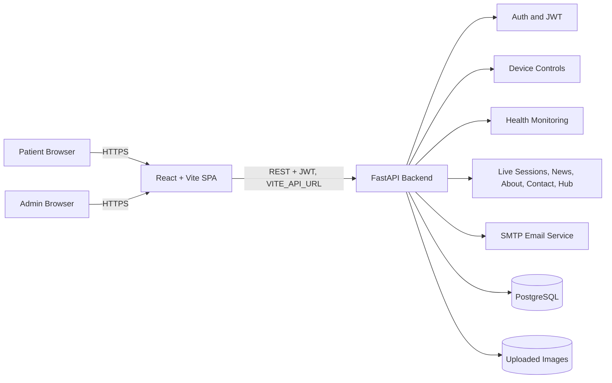

<div align="center">

<!-- TODO: add assets/logo.png centered banner -->
# W.O.M.B (Wellness Optimal Mind Body)


**A wellness and health monitoring platform where patients log biofeedback and therapy data, control therapy devices, watch live sessions, and admins manage users and content.**

<!-- TODO: screenshot/GIF - the patient Health Monitoring Dashboard showing device control cards and the health data forms -->

</div>

> [!NOTE]
> This is a working product UI backed by a real REST API. Some parts use sample or placeholder data: past live session view counts are mocked in the frontend, and the Live Sessions, News, About, and Contact pages render whatever the admin has entered. The frontend reads its API base URL from `VITE_API_URL` and expects the FastAPI backend in this repository to be running.

## Table of Contents

- [About](#about)
- [Features](#features)
- [Tech Stack](#tech-stack)
- [Architecture](#architecture)
- [Getting Started](#getting-started)
- [Project Structure](#project-structure)
- [Configuration](#configuration)
- [Roadmap](#roadmap)
- [Contributing](#contributing)
- [License](#license)

## About

W.O.M.B (Wellness Optimal Mind Body) is a full health and wellness platform. It pairs a React single page application with a FastAPI backend so that patients can record their health metrics, operate connected therapy devices, and follow live wellness sessions, while administrators manage accounts and site content from a dedicated panel.

The patient dashboard centers on two things. First, a set of device controls for therapy hardware: a sound system, LED light therapy, a steam generator, a nanoflicker, a temperature tank, and a water pump. The dashboard polls the backend every few seconds to keep the latest device state in view. Second, a set of structured health data forms for biofeedback, burn progress, brain monitoring, and heart-brain synchronicity, each with its own history view.

New sign-ups are not active right away. Accounts start in a pending state and need admin approval before login is allowed, which is why the app includes a pending-approval screen and an admin approval workflow. Authentication uses JWT access tokens stored in the browser, with automatic logout when a token expires.

Note on naming: the GitHub repository is named `frontVincy`, but the code is actually a monorepo that contains both the frontend (`frontVincy/`) and the FastAPI backend (`backvincy/`). The product brand in the code is W.O.M.B. See the rename recommendation in the project notes.

## Features

- JWT authentication with separate user and admin login flows.
- Account approval workflow: new sign-ups stay pending until an admin activates them.
- Patient health dashboard with live device controls that poll the backend every 3 seconds.
- Therapy device controls: sound, LED light therapy, steam, nanoflicker, temperature tank, and water pump, each with a history view.
- Structured health data forms with per-field history: biofeedback, burn progress, brain monitoring, and heart-brain synchronicity.
- Live sessions page with current, upcoming, and past sessions, including embedded YouTube playback.
- Public content pages for About, News, and Contact, all editable from the admin panel.
- Admin panel to manage users, hub categories and entries, news, about, contact details, and live sessions.
- Knowledge hub with public categories and per-user hub entries.
- Light and dark theme support, plus toast notifications and a responsive shadcn/ui interface.

## Tech Stack

| Layer | Technology |
|-------|------------|
| Language | TypeScript (frontend), Python (backend) |
| Frontend framework | React 18 with Vite |
| Build plugin | @vitejs/plugin-react-swc |
| UI components | shadcn/ui (Radix UI primitives) |
| Styling | Tailwind CSS, tailwindcss-animate |
| Routing | React Router DOM v6 |
| Data fetching | TanStack Query, Axios, native fetch wrapper |
| Forms and validation | React Hook Form, Zod |
| Charts | Recharts |
| Icons | lucide-react |
| Notifications | Sonner |
| Backend framework | FastAPI |
| ORM and migrations | SQLAlchemy, Alembic |
| Database | PostgreSQL (psycopg2) |
| Auth and security | JWT, passlib, bcrypt |

## Architecture



## Getting Started

This repository holds two applications: the frontend in `frontVincy/` and the backend in `backvincy/`. Run the backend first, then the frontend.

### Prerequisites

```bash
# Frontend
node >= 18
npm            # or bun, a bun.lockb is included

# Backend
python >= 3.11
pip
# A reachable PostgreSQL database
```

### Backend (FastAPI)

```bash
cd backvincy
python -m venv venv
source venv/bin/activate        # on Windows: venv\Scripts\activate
pip install -r requirements.txt

# Create a .env in backvincy/ with at least DATABASE_URL and SECRET_KEY
# (see the Configuration section), then start the API:
uvicorn app.main:app --reload --port 8000
```

The interactive API docs are then available at `http://localhost:8000/docs`.

### Frontend (React + Vite)

```bash
cd frontVincy
npm install

# Point the frontend at your backend. Edit frontVincy/.env:
# VITE_API_URL=http://localhost:8000

npm run dev
```

The dev server runs on `http://localhost:8080` (set in `vite.config.ts`).

### Available frontend scripts

```bash
npm run dev          # start the Vite dev server on port 8080
npm run build        # production build
npm run build:dev    # build in development mode
npm run preview      # preview the production build
npm run lint         # run ESLint
```

## Project Structure

```text
.
|-- frontVincy/             # React + Vite + TypeScript frontend
|   |-- src/
|   |   |-- pages/          # Landing, Login, SignUp, Dashboard, AdminDashboard, Hub, LiveSession, ...
|   |   |-- components/     # Navbars, DeviceCard, DataForm, history modals, admin editors
|   |   |   |-- ui/         # shadcn/ui components
|   |   |   `-- admin/      # Admin managers and tables
|   |   |-- hooks/          # useAuth, useTheme, useLiveSessions
|   |   |-- lib/            # api.ts fetch wrapper, utils
|   |   `-- services/       # LiveSessionService (Axios)
|   |-- index.html
|   |-- vite.config.ts      # dev server port 8080, "@" alias to src
|   `-- package.json
`-- backvincy/              # FastAPI backend
    `-- app/
        |-- api/            # Route modules (auth, users, devices, health, admin, public)
        |-- crud/           # Database access functions
        |-- models/         # SQLAlchemy models
        |-- schemas/        # Pydantic schemas
        |-- core/           # config and security
        |-- services/       # email and user services
        `-- main.py         # FastAPI app entrypoint
```

## Configuration

The frontend reads a single environment variable from `frontVincy/.env`.

| Variable | Description | Example |
|----------|-------------|---------|
| `VITE_API_URL` | Base URL of the FastAPI backend | `http://localhost:8000` |

The backend reads its settings from `backvincy/.env` (see `app/core/config.py`).

| Variable | Description | Default |
|----------|-------------|---------|
| `DATABASE_URL` | PostgreSQL connection string | required, no default |
| `SECRET_KEY` | Secret used to sign JWT tokens | required, no default |
| `ALGORITHM` | JWT signing algorithm | `HS256` |
| `ACCESS_TOKEN_EXPIRE_MINUTES` | Access token lifetime | `15` |
| `REFRESH_TOKEN_EXPIRE_MINUTES` | Refresh token lifetime | `1440` |
| `SMTP_HOST` | SMTP server for notification emails | `smtp.gmail.com` |
| `SMTP_PORT` | SMTP port | `587` |
| `SMTP_USER` | SMTP username | optional |
| `SMTP_PASSWORD` | SMTP password or app password | optional |
| `ADMIN_EMAILS` | Comma separated admin email list | optional |

> [!WARNING]
> Do not commit real secrets. Keep every `.env` file out of version control and provide a `.env.example` with placeholder values instead.

## Roadmap

- [ ] Add a `.env.example` for both the frontend and the backend.
- [ ] Replace mocked live session view counts with real values from the API.
- [ ] Remove committed build artifacts and lockfile noise from version control.
- [ ] Add automated tests for the API and the frontend.
- [ ] Add CI for lint, build, and tests.
- [ ] Publish API documentation and deployment guides.

## Contributing

Contributions are welcome. Open an issue to discuss a change, then send a pull request. Please run `npm run lint` in `frontVincy/` before submitting frontend changes.

## License

Distributed under the MIT License. See [LICENSE](LICENSE).
